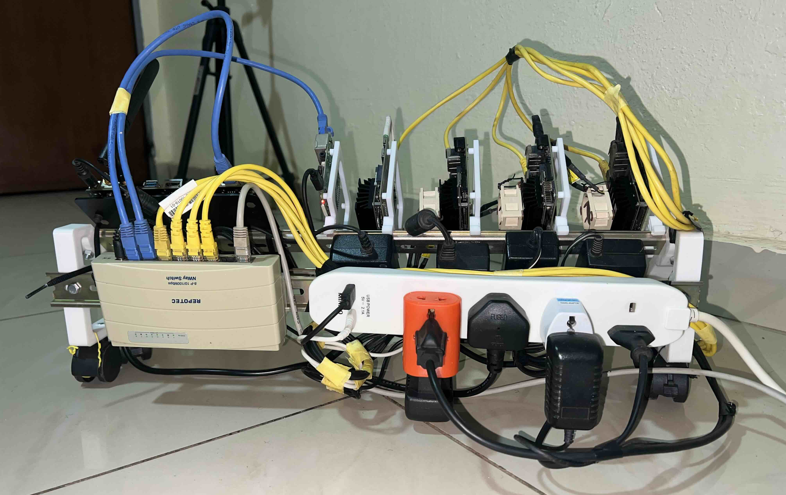
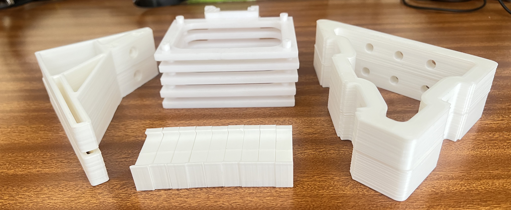
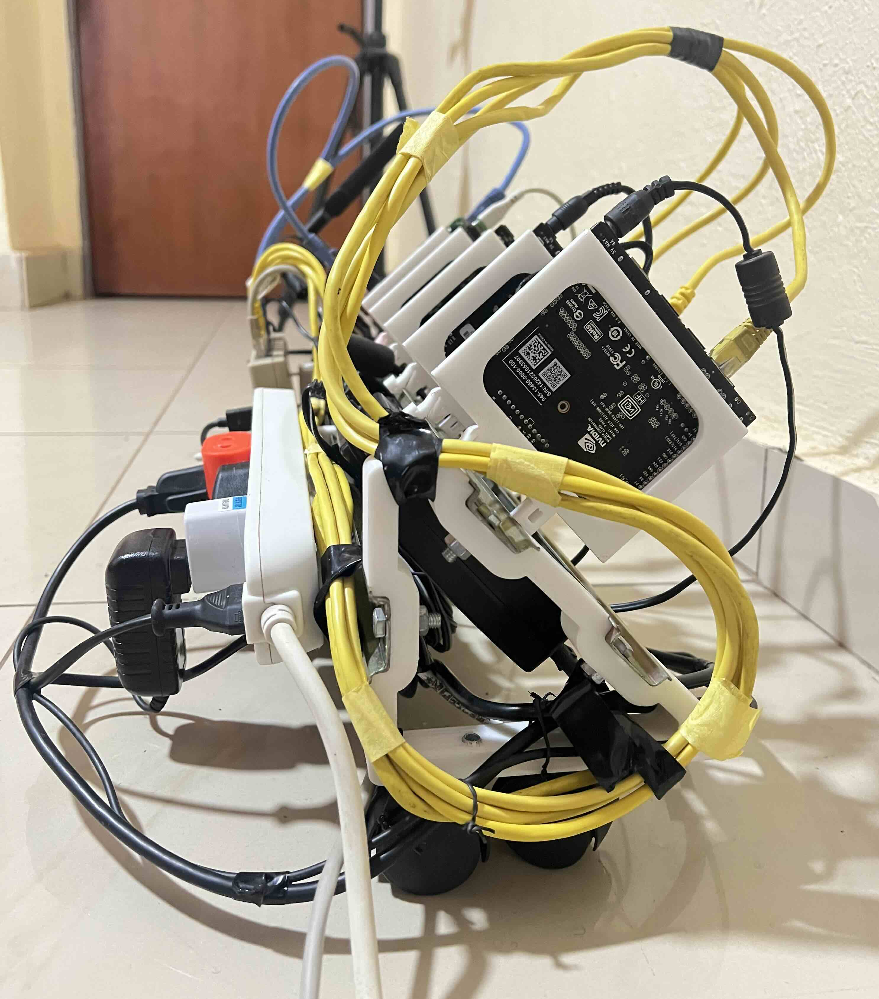

    

Building a homelab was something I had been thinking about for a while. The goal was straightforward: put together a cluster of edge devices, network them, and show that federated learning could actually be done on constrained hardware. No cloud. No simulation. Real boards, real cables, real constraints.

The setup involved several boards networked together with ethernet cables. Some of the mounting and structural parts were 3D printed, which kept things compact and gave the whole cluster a bit of personality. Getting everything physically assembled and communicating over the network was satisfying in that particular way that hardware work tends to be: slow, fiddly, and then suddenly it just works.

    

The lab eventually fed directly into the [NVFlare project](https://www.nvidia.com/en-us/on-demand/session/nvidiaflareday25-nvfd32/?playlistId=playList-4dd15c3d-2422-425c-b9d9-d21694397574), where it was put to real use. That gave the whole thing purpose beyond just being a proof of concept sitting on a shelf.

One thing I was not happy with was the power setup. Each board ended up with its own individual power supply, which meant a tangle of cables and no clean way to manage it all. It worked, but it was not elegant. The obvious improvement is a unified power supply with a proper distribution system feeding all the boards from a single source. That is on the list.

    

The next version of this homelab is already taking shape in my head. Same idea, different purpose: rather than federated learning, the next build will be focused on benchmarking. More structured, more deliberate, and hopefully with the power situation sorted out from the start.

For now, the first version did what it was supposed to do. Federated learning on edge hardware, assembled from scratch, 3D printed parts and all.
