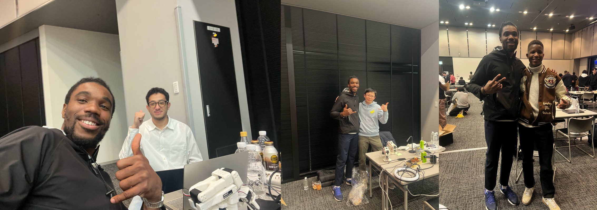
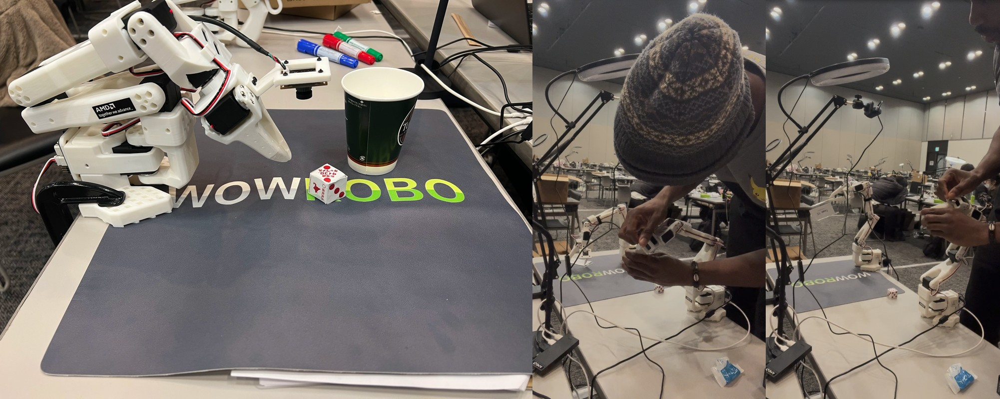
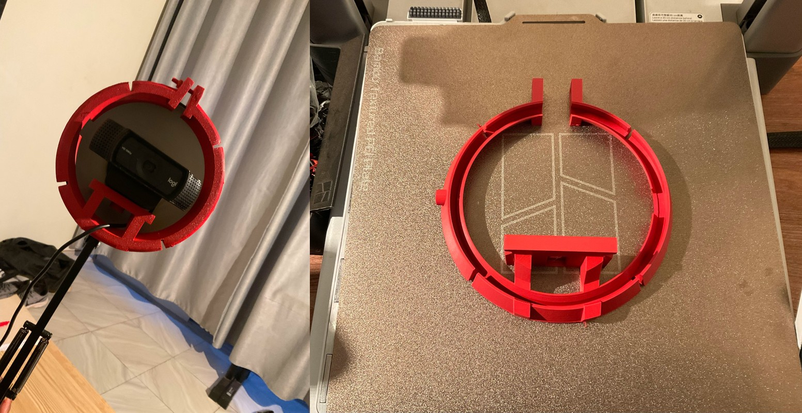
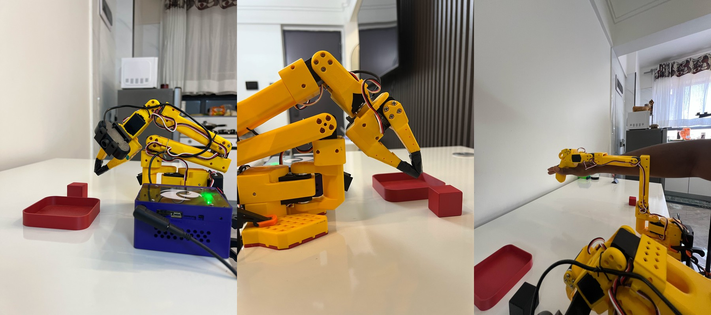
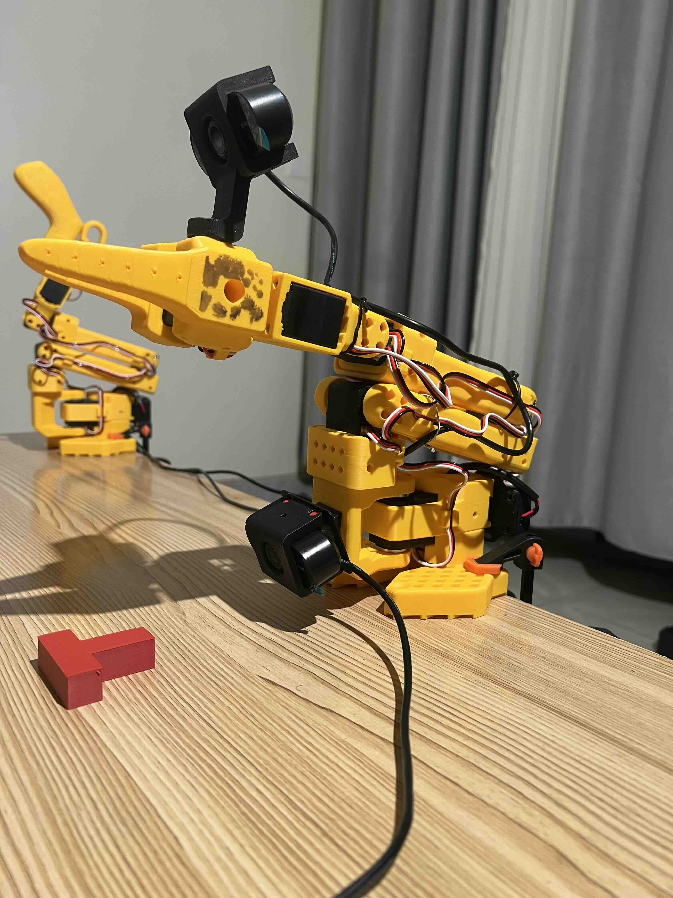

    

My robot learning journey started in Japan. While I was in Tokyo, I took part in the AMD robotics hackathon, and it was my first real exposure to low-cost robotic arms. The learning curve was steep. In about three days, I had to learn how to calibrate the arm, how to collect data, and how to build and train a model. It was overwhelming in the best way.

    

My team did not win, but that was not really the point. A lot has been happening in robotics, and I wanted to put myself in a room where I could absorb as much as possible. For me, the hackathon was a kind of exposure therapy. It took the field from something I watched from a distance to something I had my hands on.

    

When I got back to Kigali, I ordered my own LeRobot arm. I have had it for a while now, and it has become my main way of exploring what people now call robot learning.

    

It is worth saying why this field feels so alive right now. Machine learning is reshaping robotics. There are many more robot embodiments to work with. Data generation is still a limitation, but it is being addressed, and learned models are starting to solve problems that used to be out of reach. Hardware is also getting cheaper, which means more people can get involved, and I count myself as one of them.

Since then, I have run a handful of experiments. I started by asking whether a robot could learn without machine learning at all. I built an explicit system based on kinematics and inverse kinematics, and used it to perform basic actions like picking up a cube and placing it somewhere else. It worked, and it taught me a lot about what the arm is physically doing.

Eventually I pivoted to the Action Chunking Transformer, or ACT, which learns the behaviour from demonstrations instead of hand-written maths. I have also played with SmolVLA, a small vision-language-action model, and with the Pi model from Physical Intelligence.

    

The most interesting part came next: taking these policies off the workstation and running them on an edge device. I did a series of experiments deploying and testing them on the Qualcomm Dragonwing. Training a policy is one thing. Getting it to run well on constrained hardware, next to a real arm, is a different kind of problem, and it taught me a lot about what deployment actually demands.

<!-- 

    

 -->
Going from explicit kinematics to ACT, then to VLA models, and finally to edge deployment has been a fascinating progression. Each step trades a bit of hand-built control for more generality, and each one comes with its own lessons about data, calibration and hardware.

## Projects

If you want to dig into the experiments behind this post, here are the two main ones:

- [Explicit robot learning with kinematics and inverse kinematics](https://www.hackster.io/gigwegbe/explicit-pick-and-place-on-the-qualcomm-dragonwing-iq-9075-033f50)
- [Imitation learning with the Action Chunking Transformer](https://www.hackster.io/gigwegbe/imitation-learning-from-cpu-to-npu-on-dragonwing-iq-9075-f31a0a)

It has been an amazing experience so far, and there is plenty more to explore. Next up, I am taking this beyond the arm and onto a mobile base, and I will write that up here too.

I am also looking toward trying the i2RT YAM robotic arm, which is a more sophisticated platform, and I am curious to see what that opens up in terms of capability and control.
