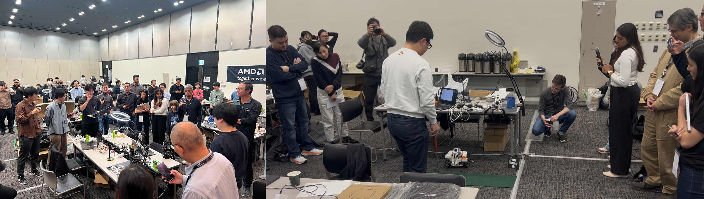
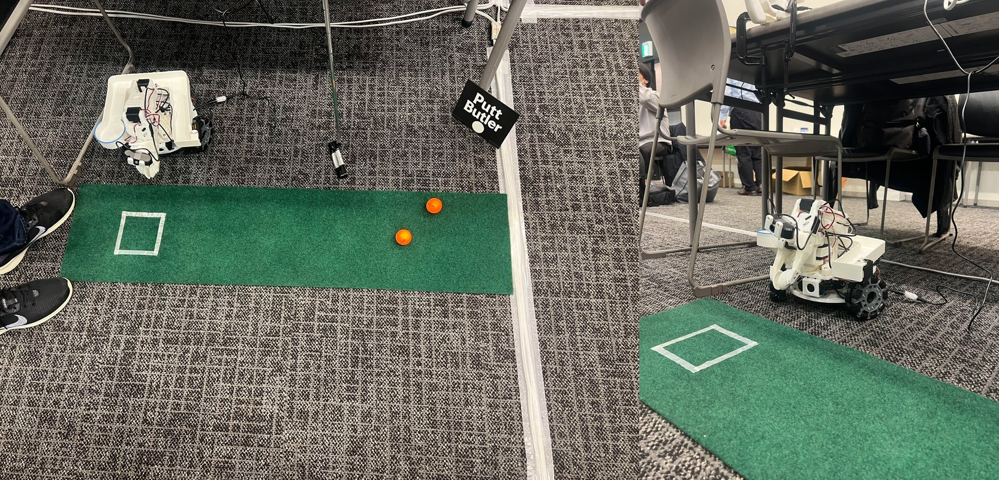
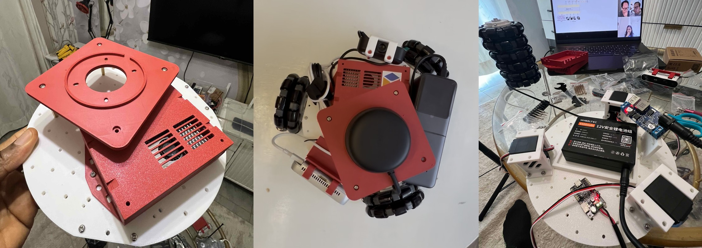
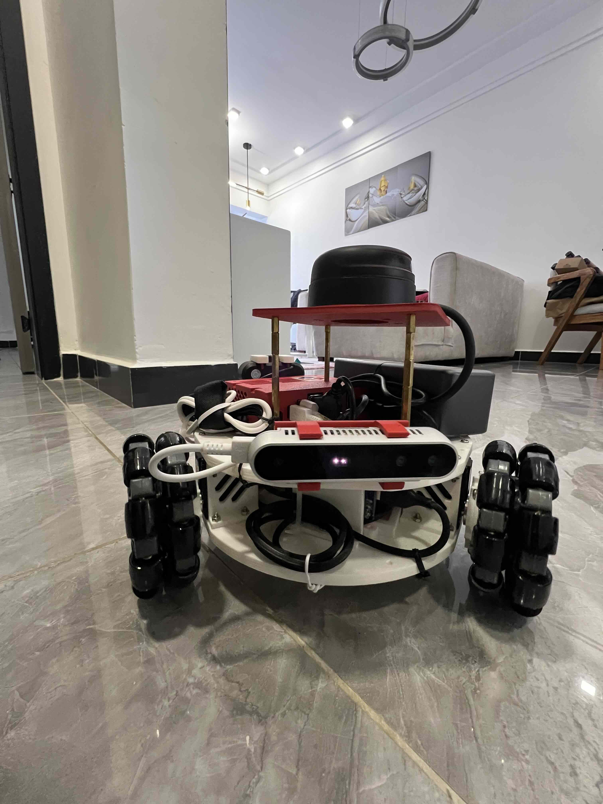

    

The idea for this project started in Japan. While we were working on the LeRobot arm at the hackathon, I came across a few people building mobile robot projects. One of them was Putt Butler, a robot navigating a putting green. Seeing what they were doing stuck with me. It was a clear inspiration, and when I got back, I decided to build one of my own.

    

I picked up the LeKiwi, an omni-wheel mobile robot, and assembled it myself. The write-up said it should take about six hours. It took me closer to three days. This was my first time putting one together, I was on vacation without access to my 3D printer, and I did not want to break anything, so I went slowly and figured things out as I went. If I did it again, I could do it much faster. It was an amazing learning experience.

    

The build involved a lot of 3D printed parts. The chassis, motor mounts, and the top plate where everything sits were all printed in red. Looking at the spread of parts on the table during assembly, the 4500mAh 12V lithium battery pack, the motor controllers, the depth sensor, and all the wiring, it was clear this was going to take some patience.

The biggest issue I ran into was power. The battery that comes with the robot was not enough for everything running at once. I added a power bank of about 20,000mAh on top of that, and the combination did the job. It was a good lesson in how quickly power becomes the limiting factor on a mobile platform.

    

Once the base was running, I added a depth sensor and a LiDAR, mostly to get a real feel for how LiDAR works in practice. The top-down view of the finished robot shows just how much is packed onto that platform: omni wheels on all three sides, the depth camera up front, the power bank strapped to the side, and the Rubik Pi sitting on top tying it all together.

From there I put together a project using the Rubik Pi with the LeKiwi, which brought the whole thing together as a working edge-powered mobile robot.

## Project

The project is done, and you can find it here:

- [LeKiwi mobile robot with the Rubik Pi](https://www.hackster.io/gigwegbe/building-a-mobile-robot-with-rubik-pi-3-lekiwi-and-rerun-964711)

## What's next

There are two things I want to try next. The first is mounting a Reachy Mini on top of the mobile base, so the robot can move around and interact. The second is running a VLA model that lets me control the robot.

More on that soon.
